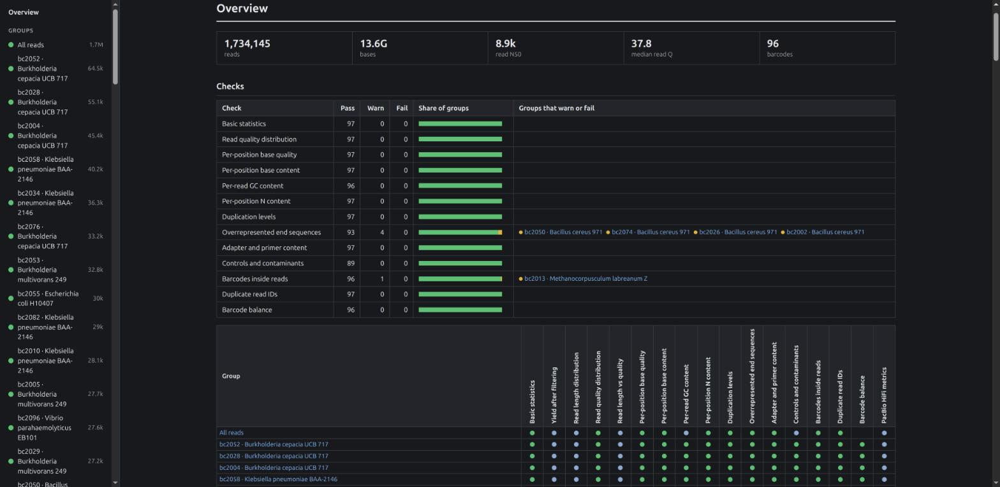
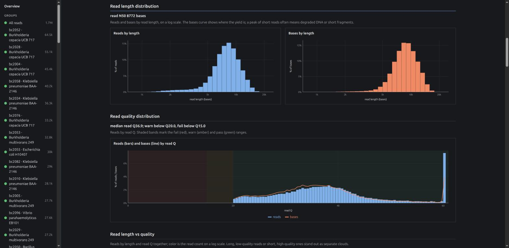

# lrQC

Per-barcode quality control for Oxford Nanopore and PacBio long reads, in one fast Rust
binary.

lrQC reads a run's BAM, FASTQ or FASTA files, a MinKNOW output folder, a sequencing summary or
standard input, splits the reads by barcode, and writes a FastQC-style report for every barcode
and for the whole run: pass/warn/fail checks, barcode comparisons, and a screen for spike-in
controls, contaminants and leftover adapters and barcodes. One self-contained HTML page, no
JavaScript, no Python environment.





*From PacBio's public 2021 microbial 96-plex run.*

## Install

Download a Linux (x86_64) binary from the
[releases](https://github.com/DylanCosto/lrQC/releases), or build it with Rust 1.91 or newer:

```sh
cargo install --locked lrqc
```

## Quick start

```sh
lrqc run/bam_pass -o qc/                      # a MinKNOW run, split by barcode
lrqc m84011.hifi_reads.bc*.bam -o qc/         # lima's per-barcode HiFi BAMs
lrqc calls.bam -o qc/ --fail-on fail          # exit 2 if any check fails
lrqc /data/run42 --watch 300 -o qc/           # follow a run as it sequences
lrqc compare qc-run41/ qc-run42/ -o trend/    # compare earlier reports
```

Then open `qc/report.html`. lrQC also writes `summary.tsv`, `qc.json`, MultiQC files and,
with `--per-read`, a table of every read.

## What it checks

Read length and quality, per-position quality and base content, GC, duplication,
overrepresented sequences, adapters and leftover barcodes, cross-talk between samples, barcode
balance, controls and contaminants (lambda, ENO2, ERCC, SIRV, phiX, E. coli, Mycoplasma, human,
vectors), and ONT and PacBio run detail: channels, duplex, yield over time, passes, kinetics and
base modifications. Each check passes, warns or fails, with levels you can change.

## More

- [Using lrQC](docs/usage.md): inputs, barcodes, every check and its levels, options,
  `--watch`, `compare`, performance and limits.
- [How lrQC works](docs/methods.md): the methods behind the checks and how they were validated.
- [Benchmarks](BENCHMARKS.md): lrQC against eight long-read QC tools.
- [The per-read table](docs/per-read.md) and the [changelog](CHANGELOG.md).

## License

MIT. Built-in reference sequences come from NCBI, Thermo Fisher (ERCC), Lexogen (SIRV), ONT
and PacBio; see [How lrQC works](docs/methods.md). If lrQC helps your work, please cite
https://github.com/DylanCosto/lrQC.
